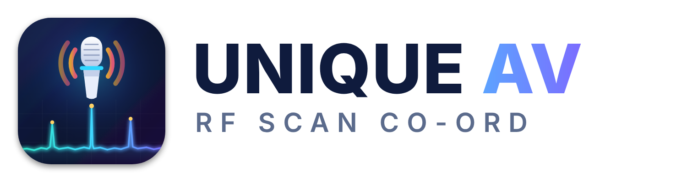

<p align="center">
  <picture>
    <source media="(prefers-color-scheme: dark)" srcset="Resources/Logo/Logo-dark.png">
    
  </picture>
</p>

# Unique AV RF Scan Co-ord

Wireless mic control & RF scanning for macOS

A native macOS app (SwiftUI, no browser) for running wireless microphone systems:
control **Shure** (including older UHF-R) and **Sennheiser** receivers over the network, plan **Wisycom**, **Sound Devices** and **Deity** alongside them, scan with a **tinySA Ultra**,
coordinate intermod-free frequencies, and keep an eye on everything during the show.

> Status: first version, written without access to the hardware. The protocol, parsing and
> coordination code has unit tests, but the device drivers still need checking on real
> receivers. Please report what works and what doesn't. See [Hardware status](#hardware-status).

## Features

| Area | What it does |
|---|---|
| **Other brands** | Wisycom, Sound Devices Astral and Deity THEOS as manually entered receivers (their makers publish no control protocol), so mixed-brand shows are coordinated together. |
| **Tuning ranges** | Optional per-receiver tuning range and step (e.g. Shure G50 470–534 MHz, 25 kHz). Coordination only proposes frequencies each receiver can tune to. |
| **Device control** | Live name, frequency, gain, mute, RF A/B, audio meters, battery bars/minutes. Edit name/frequency/group per channel. Auto-reconnect. Finds Shure receivers on the local network. |
| **Spectrum** | Live tinySA Ultra trace, peak hold, **waterfall**, overlays of saved/imported scans, TV-channel grid, restricted bands, channel markers, intermod products, hover read-out. |
| **Other scanners** | Import scans exported from **Shure Wireless Workbench** (AXT600 or receiver scans), **Sennheiser WSM**, SoundBase, RF Explorer, tinySA-App (CSV/TXT, MHz/kHz/Hz auto-detected). Live drivers plug into `SpectrumSource`. |
| **Coordination** | Spacing, 3rd-order 2-Tx and 3-Tx, and 5th-order checks; avoids scanned signals above a threshold, restricted bands and your own exclusions. Lock channels, preview proposals on the spectrum, then apply them to the receivers in one click. |
| **Time-of-use** | Groups with time slots (e.g. *Act 1 18:00–19:30*). Groups that never overlap can share frequencies, and conflicts are only flagged between transmitters on air at the same time. 24-h schedule chart. |
| **Health check** | Every second: receiver offline, low RF, low battery, audio clipping, frequency in a restricted band, intermod/spacing conflict, signal at your frequency in a reference scan. Mac notifications + beep on critical. |
| **Telemetry timeline** | Records RF, audio, battery and online state per channel (12 h), with alert events on the timeline. Hover to read values. Export CSV. |
| **Projects** | One project per show/venue: receivers, groups, plans, thresholds, region and overlays. Duplicate, export/import `.uavproj`. |
| **Venue scan library** | Every saved or imported scan is kept, tagged by venue, to reuse next time you work there. |
| **Inventory** | Equipment list (make, model, serial, tag, band), check-out/check-in with a log, totals per model, CSV export. |
| **Phone / tablet monitor** | Built-in web page with every channel live (frequency, RF, audio, battery, alerts) and the spectrum. Open it by scanning the QR code on the *Remote & Companion* page. Optional mute/scan control. |
| **Bitfocus Companion** | HTTP API for Stream Deck buttons through Companion's *Generic HTTP Requests* module: mute/unmute, gain, start/stop scan, find and apply frequencies, plus plain-text values (battery, RF, mute, alerts) for feedback. |
| **Auto update** | Checks this repo's GitHub Releases, downloads the new version, replaces the app and restarts it (*Unique AV RF Scan Co-ord › Check for Updates…*). |
| **Licensing** | 60-day trial, then one Mac per licence (Keygen). Works 30 days offline. Move to a new Mac yourself, even if the old one is lost or broken. See [LICENSING.md](LICENSING.md). |
| **Regions** | **South Africa** (8 MHz UHF Ch21–69, IMT700/IMT800 mobile bands blocked, 470–694 MHz default), United States (6 MHz, Ch37 + 600 MHz mobile blocked), Europe/CEPT. |

## Install (on your Mac)

In Terminal, inside this folder:

```bash
./install.sh
```

It installs Apple's build tools if they're missing (run it again after they finish), builds the app, puts it
in **Applications** and opens it. Use `./install.sh --demo` to open it with a demo receiver and simulated analyzer.
Run the same command again to update after pulling new code.

## Build and run (on your Mac)

You need macOS 13 Ventura or newer and Apple's developer tools:

```bash
xcode-select --install
```

Then in this folder:

```bash
./build_app.sh
```

```bash
open "build/Unique AV RF Scan Co-ord.app"
```

Drag `build/Unique AV RF Scan Co-ord.app` into **Applications** to keep it. The first time it connects to a
receiver, macOS asks for **Local Network** access. Click *Allow*.

To work on the code, open `Package.swift` in Xcode and press Run. Run the unit tests with:

```bash
swift test
```

To try everything without hardware (a demo receiver plus the simulated analyzer, already scanning):

```bash
open "build/Unique AV RF Scan Co-ord.app" --args --demo
```

## Quick start

1. **Project** page: name the show, set the **venue** and **region** (default *South Africa*).
2. **Devices** page: add receivers by IP, or use *Search* to find Shure units. Add a *Demo
   receiver* to try the app without hardware.
3. Plug in the **tinySA Ultra** (USB-C), choose *tinySA* and its `usbmodem…` port in the Scan
   panel, then *Connect* and *Scan*. *Simulated analyzer* works without hardware.
4. Take a scan with your own transmitters **off**, then *Save to library*. Show it as an overlay so
   it becomes the reference scan for coordination and interference alerts.
5. **Coordinate** tab: tick the channels to change (lock the rest) and press *Find frequencies*.
   Check the proposals on the spectrum, then *Apply all*. Re-sync the transmitters (IR sync).
6. Watch the **Health check** badge in the toolbar and the **Timeline** during the show.

### tinySA tips

* Unique AV RF Scan Co-ord splits wide spans into 450-point sweeps (the Ultra's maximum) on an exact grid.
* 25 kHz step and RBW *Auto* or 30–100 kHz work well for UHF mics.
* For spans under 800 MHz Unique AV RF Scan Co-ord switches the tinySA to *low input* mode.

## Phone monitor (QR code)

1. Open **Remote & Companion** in the sidebar. The web server runs on port 8088 by default.
2. Scan the QR code with the phone's camera. The phone has to be on the same network as the Mac.
3. Tip: on iPhone use *Share › Add to Home Screen* to get it full-screen like an app.

The link contains an access key. *New key* invalidates every old QR code and Companion button.
The monitor is read-only unless you switch on **Allow control**.

## Bitfocus Companion (Stream Deck)

Add a **Generic: HTTP Requests** connection in Companion and use **GET** actions. The
*Remote & Companion* page lists the exact URLs (with your IP and key) and the channel numbers.

| Action / value | URL (add `?key=YOUR_KEY`) |
|---|---|
| Toggle / set mute | `/api/ch/1/mute/toggle`, `/api/ch/1/mute/on`, `/api/ch/1/mute/off` |
| Gain up / down | `/api/ch/1/gain/up`, `/api/ch/1/gain/down` |
| Scan start / stop / toggle | `/api/scan/start`, `/api/scan/stop`, `/api/scan/toggle` |
| Find / apply frequencies | `/api/coordinate`, `/api/apply` |
| Channel values (plain text) | `/api/ch/1/name`, `freq`, `rf`, `rfa`, `rfb`, `audio`, `battery`, `batterymin`, `gain`, `mute`, `online`, `alerts`, `group` |
| Alert count | `/api/alerts/count` |
| Everything (JSON) | `/api/state`, `/api/spectrum`, `/api/channels` |

Control actions need **Allow control** to be on. The key can also be sent as an `X-UniqueAV-Key` header.

## Updates and releases

Unique AV RF Scan Co-ord checks the [Releases](https://github.com/Jeansenekal-tech/rf-microphone-control-and-scan-/releases)
of this repository (at most every 6 hours, or *Unique AV RF Scan Co-ord › Check for Updates…*). It downloads
`Unique-AV-RF-Scan-Co-ord.zip`, replaces the app and restarts.

To publish a new version, raise `CFBundleShortVersionString` in `Resources/Info.plist`
(e.g. `0.1.0` → `0.2.0`) and push to `main`. GitHub Actions builds a universal
(Apple Silicon + Intel) app and publishes it as release `v0.2.0`. Pushing a `v*` tag works too.

The app is signed ad-hoc (not notarized). If macOS refuses to open a copy downloaded with a browser,
right-click › Open, or remove the quarantine flag:

```bash
xattr -dr com.apple.quarantine "/Applications/Unique AV RF Scan Co-ord.app"
```

Updates installed by the app itself aren't affected by this.

## Hardware status

| Device | Protocol | Status |
|---|---|---|
| Shure ULX-D, QLX-D, SLX-D, Axient Digital | Command strings, TCP 2202 | Public protocol. Meter scaling follows ULX-D/QLX-D (RF = v−128 dBm, audio = v−50 dBFS); Axient Digital meters may need adjusting. |
| Shure UHF-R (UR4S, UR4D) | Command strings with `* … *` framing, UDP 2202 | Based on Shure's UHF-R command string document. Gain offset and meter scaling are not yet verified (see `UHFRDevice.Tuning`). Enter the IP manually. |
| Sennheiser ew G3 / G4 / 2000 / 9000 | ASCII over UDP 53212 | Commonly used protocol. RF/AF meters are mapped approximately. |
| Sennheiser EW-DX EM 2 / EM 4 | SSCv2 (HTTPS REST, user `api`) | **Experimental.** Enable SSCv2 / third-party access and set a password on the receiver. Endpoint paths are in `EWDXDevice.Path`. |
| Sennheiser Digital 6000 | SSC v1, JSON over UDP 45 | **Experimental.** |
| tinySA / tinySA Ultra | USB serial shell (`scan` command) | Public protocol. |
| Shure AXT600, receiver-based scans, Sennheiser WSM scans | Not public | Use **Import** with CSV exported from WWB / WSM. A live driver can be added in `SpectrumSources.swift` if the protocol becomes available. |
| Wisycom (MRK16, MCR54, MRK960…) | No public protocol (Wisycom Manager only) | **Manual entry**: channels typed in and saved with the project; part of coordination, conflicts, spectrum, monitor. Set frequencies on the receiver. |
| Sound Devices Astral (A20-Nexus, A20-RX…) | No public API (built-in web app) | **Manual entry**, plus *Open web control* for the A20-Nexus web app at its IP. |
| Deity THEOS (D2RX, D4RX…) | No network port (Bluetooth / Sidus Audio app) | **Manual entry**. |

If Wisycom, Sound Devices or Deity publish (or share) a control protocol, a live driver can be
added in the same way as the Shure and Sennheiser ones.

> Spectrum rules change. The region data is a planning aid: always confirm with your
> regulator (ICASA, FCC, Ofcom…) and the licences you hold.

## Logo

Source artwork is in `Resources/Logo/` (`AppIcon.svg`, `Logo.svg`, `Logo-dark.svg`, plus PNGs). The macOS icon set in `Resources/AppIcon.iconset` is turned into `AppIcon.icns` by `build_app.sh`.

## Where data is stored

`~/Library/Application Support/Unique AV RF Scan Co-ord/` (data from older versions is moved here automatically)

* `Projects/*.uavproj`: projects (JSON). EW-DX SSCv2 passwords are stored in plain text in these files.
* `Scans/*.json`: venue scan library.
* `inventory.json`: equipment list and check-out log.

## Code layout

```
Sources/UniqueAVCore/   protocols, parsers, regions, schedule, frequency coordination (unit-tested)
Sources/UniqueAV/       the macOS app
  ShureDevice, UHFRDevice, SennheiserDevices, EWDXDevice, ManualDevice, DemoDevice   receivers
  SerialPort, SpectrumSources, AnalyzerController          tinySA + scanning + waterfall
  AppState, Health, Telemetry, ScanLibrary, Inventory      app logic and storage
  HTTPServer, RemoteController, MonitorPage, Updater       web monitor, Companion API, updates
  Licensing, BuildConfig                                   Keygen licensing (build-time settings)
licensing/trial-worker/  Cloudflare Worker that issues 60-day trials
  UI/                                                       SwiftUI screens
Tests/UniqueAVCoreTests/
```
